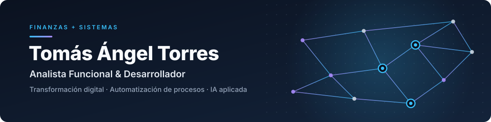

  

## Hola, soy Tomás

Analista funcional y desarrollador con base en administración y finanzas. Relevo procesos administrativo-financieros manuales y los convierto en software y automatizaciones en producción. Estudiante avanzado de Ingeniería en Sistemas de Información (UTN).

  
  
  
  

### Qué hago

- **Análisis funcional:** relevo circuitos, documento reglas de negocio y diseño la solución junto al área usuaria.
- **Desarrollo y automatización:** construyo herramientas en C# / .NET, Python y PHP que reemplazan planillas y cargas manuales.
- **Microsoft 365 y gobierno de IT:** administro identidades, dispositivos, correo y documentación de IT.
- **IA aplicada:** desarrollo asistido por IA (Claude Code, agentes) con especificaciones, pruebas automatizadas y CI/CD.

### Resultados

- ~30% menos tiempo de carga manual tras rediseñar y automatizar circuitos de facturación, manifiestos, conciliaciones y cuentas corrientes.
- Facturador electrónico integrado a ARCA/AFIP (WSAA, WSFEv1) en producción, con 30 pruebas automatizadas en CI.
- Business case de modernización tecnológica: evaluación de 4 ERPs y modelo financiero TCO/ROI presentado a gerencia local y casa matriz.
- Coordinación de la migración del correo on-premise a Microsoft 365 y administración de Entra ID, Intune, Exchange Online, SharePoint y Defender.

### Proyectos

Versiones anonimizadas de proyectos reales: datos sintéticos, sin credenciales ni información confidencial.

| Proyecto | Qué resuelve | Stack |
|---|---|---|
| [Procesador de manifiestos v2.0](https://github.com/toomastorres/maritime-manifest-processor) | Motor ETL gobernado por un catálogo de reglas en Excel: liquida comisiones, genera reportes de facturación y audita desvíos. 22 pruebas en CI. | Python · openpyxl · Streamlit · pytest · GitHub Actions |
| [Facturación electrónica ARCA/AFIP](https://github.com/toomastorres/arca-electronic-invoicing) | Emisión de comprobantes contra WSAA/WSFEv1: firma digital, CAE y PDF con QR fiscal, en Clean Architecture. | C# · .NET 8 · WPF · EF Core · SOAP |
| [Web institucional + intranet con SSO](https://github.com/toomastorres/maritime-agency-web) | Sitio multiidioma, intranet con inicio de sesión Microsoft Entra ID (OIDC + PKCE) y bot de tipo de cambio sobre Microsoft Graph. | PHP 8.2 · MySQL 8 · Entra ID · Microsoft Graph · Docker |
| [Gobierno de IT y Microsoft 365](https://github.com/toomastorres/it-governance-m365-blueprint) | Caso de administración de Microsoft 365 Business Premium y kit de 10 plantillas normativas de IT. | M365 · Entra ID · Intune · SharePoint |
| [Caso de estudio: modernización de ERP](https://github.com/toomastorres/erp-modernization-case-study) | Matriz de evaluación ponderada de 4 ERPs y modelo financiero TCO. | Análisis funcional · TCO/ROI |
| [Conciliador de fletes](https://github.com/toomastorres/maritime-freight-reconciliation) | Concilia facturas en dos monedas contra cobranzas locales, con diferencia de cambio. | Python · Excel · VBA |
| [Cuenta corriente y aging](https://github.com/toomastorres/auto-brands-current-account) | Cuenta corriente por cliente y antigüedad de deuda calculada automáticamente para reporting. | Excel · VBA |

### Stack

- **Desarrollo:** C#, .NET 8, ASP.NET Core, Entity Framework Core, Python, PHP, JavaScript, HTML/CSS, VBA, xUnit, pytest
- **Bases de datos:** SQL, PostgreSQL, MySQL, Oracle
- **Datos y finanzas:** Power BI, Excel avanzado, modelos TCO/ROI, conciliaciones, facturación electrónica ARCA/AFIP
- **Cloud e infraestructura:** Microsoft 365 (Entra ID, Intune, Exchange Online, SharePoint, Defender), Microsoft Graph API, Docker, Git, GitHub Actions, FortiGate
- **IA y automatización:** Claude Code, agentes de IA, Microsoft Copilot Studio, Azure AI, n8n, Gemini
- **Gestión:** relevamiento de procesos, BPMN, Salesforce, Jira, Confluence

### Experiencia

**Grimaldi Agencies Argentina S.A.** — Financial Analyst, Digital Transformation & IT Lead · ago 2024 – actualidad
Automatización de circuitos administrativo-financieros, facturación electrónica, administración de Microsoft 365, business case de modernización tecnológica y rendiciones de cuenta a casa matriz en Italia.

**Rosbaco & Partners** — Administrative Project Analyst & Salesforce Key User · dic 2022 – ago 2024
Adaptación de Salesforce CRM a los procesos administrativos y capacitación de usuarios.

### Formación

- Ingeniería en Sistemas de Información — UTN-FRBA · 2023 – actualidad (egreso estimado 2028)
- Carrera de Consultor en IA — EducaciónIT y Manhattan University · en curso (2026)
- Cursos Microsoft: PL-7008 (Copilot Studio), AI-901T00 (IA en Azure), AI-103 (agentes de IA en Azure) · en curso (2026)
- Desarrollador Full Stack — Alura Latam · 2022 – 2023
- Idiomas: español nativo · inglés intermedio (certificado)

---

  <a href="mailto:torrestomas.2004@gmail.com">torrestomas.2004@gmail.com</a> ·
  <a href="https://www.linkedin.com/in/tomastorres2004/">LinkedIn</a> ·
  <a href="CV.pdf">Descargar CV (PDF)</a>

