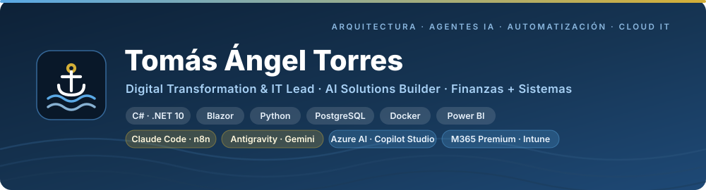

<!--
  README principal de perfil de GitHub (toomastorres/toomastorres).
-->

  

<h1 align="center">Hola, soy Tomás 👋</h1>

  <b>Transformo operaciones administrativo-financieras e infraestructura IT en software moderno gobernado por reglas y potenciado por IA.</b> 
  Perfil triple: entiendo la contabilidad y las finanzas, diseño y programo el software, y administro la nube que lo sostiene.

  <i>Digital Transformation &amp; IT Lead · AI Solutions &amp; Process Architect · Estudiante avanzado de Ing. en Sistemas (UTN)</i>

  
  
  
  

---

### 👤 Mi diferencial profesional

Trabajo en la intersección real entre **Administración y Finanzas**, **Ingeniería de Software & IA** e **Infraestructura IT**. No relevo procesos "desde afuera": opero con rendiciones internacionales, facturación fiscal, impuestos y tesorería bimonetaria, y uso ese dominio de negocio para construir sistemas con **precisión contable y cero fricción operativa**.

- 🏗️ **Arquitectura y Producto:** De relevar un circuito manual o auditar un ERP legado de +1.100 tablas a especificar reglas de negocio trazables, diseñar la arquitectura en `.NET 10` / `Python` y llevarla a producción.
- 🤖 **Ingeniería AI-Augmented & Agentes:** Dirijo flujos de desarrollo multi-agente (**Claude Code · Google Antigravity · Gemini · n8n · Microsoft Copilot Studio · Azure AI**) bajo especificaciones estrictas, ADRs, catálogos de reglas y suites automatizadas de pruebas.
- 🛡️ **Modern Workplace & Gobierno IT:** Administración integral de **Microsoft 365 Business Premium** (`Entra ID`, `Intune MDM`, `Exchange Online`, `SharePoint`, `Defender`), redes/VPN y estandarización documental de IT.

---

### 🏆 Hitos recientes y resultados medibles

- ⚓ **Dirección y Arquitectura de un ERP & CRM Marítimo propio *(en construcción)*:** Diseño y desarrollo en `.NET 10 + Blazor + PostgreSQL 17 + Docker` para reemplazar el ERP legado en Oracle 11g, el facturador externo y las planillas de backoffice sobre una única base ACID (`17 módulos M00–M16`, `7 agentes automáticos en background` y `+600 tests automatizados`).
- 🚢 **Motor de Procesamiento de Manifiestos v2.0 *(logrado en producción)*:** Evolución de un script inicial a un paquete modular de ~5.000 líneas gobernado por catálogo Excel con **auto-descubrimiento de conceptos nuevos**, reglas `ALL IN`, apertura multi-carga en biblias, reporte de facturación para Caja (validación Módulo 11 de CUIT) y 8 categorías de auditoría automática — eliminando horas de trabajo manual por buque y detectando desvíos históricos.
- ☁️ **Administración Microsoft 365 Business Premium y Gobierno Documental IT:** Liderazgo en la migración y administración de correo (`Exchange Online`), identidades con MFA (`Entra ID`), gestión de equipos (`Intune` + `BitLocker`), migración de archivos a `SharePoint Online`, seguridad perimetral (`Defender` + `FortiGate VPN` + `KeePassXC`) y autoría desde cero del archivo normativo de IT (`IT-NOR`, `IT-POL`, `IT-FT`, `IT-INS`, `IT-PRO`).
- 📊 **Business Case de Modernización IT & Eficiencia Operativa:** Evaluación técnica-financiera (TCO/ROI) de 4 proveedores ERP, consolidación en la nube y **~30% de reducción** en tiempos de carga administrativa manual.

---

### 🚀 Portafolio de Proyectos (Versiones Sanitizadas)

> ℹ️ Todos los repositorios corresponden a arquitecturas, motores y marcos de trabajo reales desarrollados para resolver problemas concretos de negocio e IT, publicados en **versión estrictamente anonimizada** (*Atlantic Maritime Agency*, datos sintéticos, tarifas ilustrativas y cero credenciales o información confidencial).

#### 🌟 Proyectos Centrales (2026)

| Proyecto | Estado | Qué resuelve y qué demuestra | Stack Principal |
|---|:---:|---|---|
| ⚓ **[Maritime Agency ERP & CRM Platform](https://github.com/toomastorres/maritime-erp-platform)** | `🚧 WIP` | **Arquitectura de ERP & CRM naviero propio:** invariante ACID *"Facturar es contabilizar"*, contabilidad bimonetaria RT 6/54, emisión ARCA, tesorería por armador, 7 workers autónomos, ADRs, **ingeniería Multi-Agente IA** y **[prototipo UI interactivo en vivo](https://toomastorres.github.io/maritime-erp-platform/prototype/)**. | `C# · .NET 10 · Blazor · PostgreSQL 17 · Docker · Multi-Agent AI` |
| 🚢 **[Procesador de Manifiestos Marítimos v2.0](https://github.com/toomastorres/maritime-manifest-processor)** | `✅ Prod v2` | **Motor ETL gobernado por catálogo de negocio:** lee manifiestos de buques y emite en segundos biblias multi-carga, comisiones (`ALL IN` / ROE / por unidad), liquidación para Caja y auditoría en hoja `REVISIÓN` sin inventar valores. Incluye **demo Streamlit** y CI. | `Python · openpyxl · Streamlit · pytest · GitHub Actions` |
| 🛡️ **[IT Governance & M365 Business Premium Blueprint](https://github.com/toomastorres/it-governance-m365-blueprint)** | `✅ Publicado` | **Modern Workplace & Gobierno IT:** caso de estudio de migración y administración de M365 Business Premium (`Entra ID`, `Intune MDM`, `Exchange`, `SharePoint`, `Defender`, VPN) + kit de **10 plantillas normativas ISO-style** reutilizables. | `M365 Premium · Entra ID · Intune · SharePoint · FortiGate · IT Governance` |

#### 🧩 Ecosistema de Herramientas y Casos de Estudio

| Proyecto | Qué problema resuelve | Stack |
|---|---|---|
| 🧾 **[Facturación Electrónica ARCA/AFIP](https://github.com/toomastorres/arca-electronic-invoicing)** | Emisión fiscal directa contra webservices SOAP de AFIP/ARCA (`WSAA`/`WSFEv1`): firma digital CMS, CAE, PDF con QR oficial RG 4892 y reglas tributarias en Clean Architecture + 30 tests en CI. | `C# · .NET 8 · WPF · EF Core · SOAP` |
| 📊 **[Caso de Estudio: Modernización de ERP & TCO](https://github.com/toomastorres/erp-modernization-case-study)** | Etapa 1 de estrategia digital: relevamiento del estado legado, matriz ponderada de 4 ERPs (SAP B1, Dynamics 365, Softland, legado), modelo financiero TCO y hoja de ruta hacia la nube. | `Análisis Funcional · TCO/ROI · Cloud Strategy` |
| 🌐 **[Web Institucional Multiidioma + Portal RBAC](https://github.com/toomastorres/maritime-agency-web)** | Sitio corporativo en 4 idiomas (ES/EN/IT/PT) + intranet privada con permisos por rol, protección CSRF, rate-limiting, auditoría de eventos y *bridge* controlado de lectura para agentes IA. | `PHP 8.2 · MySQL · JS · Docker` |
| ⚓ **[Conciliador Bimonetario de Fletes](https://github.com/toomastorres/maritime-freight-reconciliation)** | Concilia facturas de flete de casa matriz contra cobranzas locales contemplando trasbordos, motor de diferencia de cambio (ROE) y rendición por viaje/buque. | `Python · Excel · VBA` |
| 🚗 **[Cuenta Corriente y Aging Automotriz](https://github.com/toomastorres/auto-brands-current-account)** | Sistema en planillas event-driven que mantiene la cuenta corriente de cada terminal automotriz y calcula automáticamente la antigüedad de deuda para reporting internacional. | `Excel · VBA` |

---

### 🛠️ Stack Tecnológico y Herramientas

**Desarrollo de Software, Backend & Datos**  

**Inteligencia Artificial, Agentes & Automatización**  

**Cloud, Microsoft 365 Business Premium & Infraestructura IT**  

**BI, Gestión & Análisis Funcional**  

---

### 🤖 Cómo integro la IA en Ingeniería y Negocio

No uso la IA para copiar código a ciegas: aplico **Spec-Driven AI Engineering**.
1. **Gobierno por reglas de negocio:** Cada requerimiento nace en un catálogo con ID único (`VTA-01`, `CTB-04`, `MAN-02`), pasa por decisiones arquitectónicas documentadas (**ADRs**) y recién entra a construcción cuando está validado con el área usuaria.
2. **Orquestación de subagentes especializados:** Coordino agentes con roles acotados (*analista funcional, desarrollador .NET, especialista ARCA, migración de datos, QA y revisor de código*), evitando conflictos con inyección de dependencias modular y *PR chaining*.
3. **Verificación determinística:** Ningún motor "inventa" importes — los cálculos financieros usan precisión `decimal` estricta, controles cruzados automáticos y suites de integración en CI, derivando toda ambigüedad a bandejas humanas de revisión.
4. **Automatización e integración empresarial:** Desarrollo de agentes y flujos con **n8n**, **Microsoft Copilot Studio**, **Azure AI**, **Microsoft Graph** y *bridges* controlados de lectura sobre datos operativos.

---

### 💼 Experiencia Profesional

**Grimaldi Agencies Argentina** — *Financial Analyst, Digital Transformation & IT Lead* · `ago 2024 – actualidad`
- **Product Owner y Arquitecto del ERP & CRM interno (`.NET 10`):** Lidero el reemplazo del ERP legado, facturador externo y planillas operativas integrando contabilidad bimonetaria, facturación ARCA, manifiestos, cuentas corrientes, tesorería y rendiciones internacionales.
- **Desarrollo y evolución de motores en producción:** Creación y mejora continua del Procesador de Manifiestos v2.0, facturador electrónico AFIP/ARCA, conciliador de fletes y portal web corporativo.
- **Administración de Microsoft 365 Business Premium e Infraestructura IT:** Gestión de `Entra ID` (MFA/accesos), `Intune` (MDM/equipos), `Exchange Online`, `SharePoint`, `Defender`, firewall/VPN, backups y creación íntegra del marco documental normativo de IT de la compañía.
- **Operación financiera internacional y BI:** Responsable de rendiciones de cuenta al armador (casa matriz en Europa), análisis TCO/ROI y tableros en Power BI.

**Rosbaco & Partners** — *Administrative Project Analyst & Salesforce Key User* · `dic 2023 – ago 2024`
- Key user de **Salesforce**: adaptación de flujos del CRM para áreas administrativas, análisis de proyectos internos y capacitación del equipo para asegurar adopción.

---

### 🎓 Formación Académica y Certificaciones

- 🎓 **Ingeniería en Sistemas de Información** — **UTN** *(Universidad Tecnológica Nacional)* · `2023 – actualidad` *(en curso, egreso est. 2028)*
- 🤖 **Carrera de Consultor IA** *(Certificación internacional)* — **EducaciónIT & Manhattan University** · `En curso (2026)`
  - *Plan de estudios:* Introducción a Python · Bases de Datos y SQL · Data Analytics & Visualization · IA y Productividad · Automatización con Claude y Claude Code · Google AI Studio con Antigravity · Automatización y Agentes IA con n8n · Vibe Coding · Business Analysis.
- ☁️ **Especializaciones Microsoft Cloud, Copilot & Certificaciones IA** · `En curso (2026)`
  - **PL-7008:** Agentes en Microsoft Copilot Studio
  - **AI-901T00:** Introducción a la IA en Azure
  - **AI-103:** Desarrollo de Agentes de IA en Azure & *Develop AI Agents on Azure*
  - **Certificaciones internacionales:** *Prompt Engineering Foundation Certification* · *AI Management Certification*
- 💻 **Desarrollador Full Stack** — **Alura Latam** · `2022 – 2023`
- 📑 **Auxiliar Administrativo, Contable y Financiero** — **Instituto CIEC** · `2022`
- 🌐 **Idiomas:** Español nativo · Inglés intermedio (certificado)

---

  <b>¿Querés transformar procesos manuales, ordenar tu ecosistema Microsoft 365 o construir software a medida potenciado por IA?</b> 
  📫 <a href="mailto:torrestomas.2004@gmail.com">torrestomas.2004@gmail.com</a> &nbsp;·&nbsp;
  💼 <a href="https://www.linkedin.com/in/tomastorres2004/">linkedin.com/in/tomastorres2004</a> &nbsp;·&nbsp;
  📄 <a href="CV.pdf">Descargar CV (PDF)</a>

